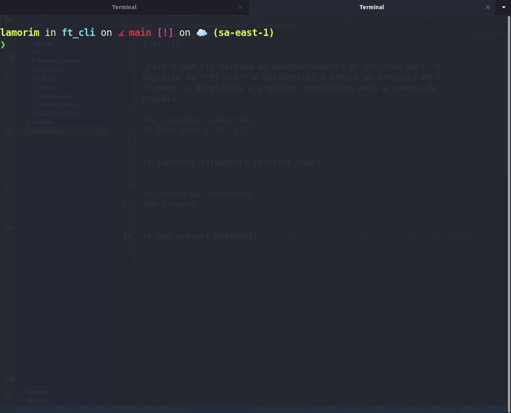

# ft *CLI*

_Esse é uma cli voltada ao desenvolvimento de projetos em C. O objetivo da **ft cli** é automatizar o começo de projetos em C, criando os diretórios e arquivos necessários para o começo do projeto._

## Como instalar

O comando a seguir instalará o projeto em sua máquina.

```sh
sudo make install
```

## Como usar a *ft cli*

```
ft [option] [argument] [project_name]
```

### Exemplo

```
ft new project minishell
```




# Prompts

Como podemos aprimorar este projeto? Por exemplo, que arquitetura de projeto poderiamos usar? E, como otimizar o código para facilitar a inclusão de novas funcionalidades?

Como podemos aprimorar um projeto em C que é uma CLI para criar arquivos para começar um projeto em C? Hoje o projeto executa apenas o comando `ft new project minishell` criando os arquivos: minishell/app/includes/minishell.h, minishell/app/src/main.c, minishell/.gitignore, minishell/README.md e minishell/Makefile. Por exemplo, que arquitetura de projeto poderiamos usar? E, como otimizar o código para facilitar a inclusão de novas funcionalidades?

# Projeto refatoração

Já tememos uma CLI que cria um template básico. Agora a evolução natural é transformar isso em uma ferramenta extensível, modular e sustentável.

## Separação sujerida:

| Módulo          | Responsabilidade             |
| --------------- | ---------------------------- |
| parser          | Interpretar argv             |
| dispatcher      | Chamar comando correto       |
| commands        | Lógica específica do comando |
| file_generator  | Criar diretórios e arquivos  |
| template_engine | Substituir variáveis         |
| fs              | Abstração de filesystem      |

## Implementar `Command Pattern` em C

Mesmo em C, podemos simular orientação a objetos usando struct + function pointers.

**Exemplo**:

```C
//Nova estrutura para comando
typedef struct s_command
{
    const char *name;
    int (*execute)(int argc, char **argv);
} t_command;

//Registro de comandos, uma array de comandos
t_command commands[] = {
    {"new", cmd_new},
    {"init", cmd_init},
    {NULL, NULL}
};

//Dispatcher
int dispatch_command(const char *cmd, int argc, char **argv)
{
    for (int i = 0; commands[i].name != NULL; i++)
    {
        if (strcmp(commands[i].name, cmd) == 0)
            return commands[i].execute(argc, argv);
    }
    printf("Unknown command\n");
    return 1;
}
```

Com isso para adicionar um novo comando fazemos:

1- Criar arquivo em `commands/`

2- Registrar no array

Zero impacto no core.

## Orientações de projeto:

1- Uma função = uma responsabilidade

2- Evitar funções com mais de 30 linhas

3- Evitar dependência circular entre módulos

4- Header minimalista

5- Nunca incluir header desnecessário

## Ordem para execução de tarefas:

Etapa 1:
Refatorar para Command Pattern + separação por módulos

getopt(), getopt_long()

Etapa 2:
Criar sistema de templates externo

Etapa 3:
Criar arquitetura de projeto mais robusta

Etapa 4:
Adicionar novos comandos

Etapa 5:
Testes + documentação

## Sugestão de comportamento

```markdown
sequenceDiagram
    participant User
    participant Main
    participant Parser
    participant Dispatcher
    participant CmdNew
    participant FileGenerator
    participant TemplateEngine
    participant ft_fs

    User->>Main: ft new project minishell

    Main->>Parser: parse(argc, argv)
    Parser-->>Main: CLIContext { command="new", args }

    Main->>Dispatcher: dispatch(context)

    Dispatcher->>CmdNew: execute(context)

    CmdNew->>FileGenerator: create_project_structure(context)

    FileGenerator->>ft_fs: create_dir("minishell/")
    FileGenerator->>ft_fs: create_dir("minishell/app/")
    FileGenerator->>ft_fs: create_dir("minishell/app/src/")
    FileGenerator->>ft_fs: create_dir("minishell/app/includes/")

    CmdNew->>TemplateEngine: render("main.c.tpl", context)
    TemplateEngine-->>CmdNew: rendered_main.c

    CmdNew->>FileGenerator: create_file(path, rendered_main.c)

    FileGenerator->>ft_fs: write_file(path, content)

    CmdNew-->>Dispatcher: SUCCESS
    Dispatcher-->>Main: EXIT_SUCCESS
```